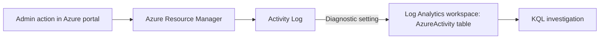

# AI Security Operations & Cloud Security Platform

A hands-on security engineering project on Microsoft Azure: an enterprise-style environment that is built, attacked, detected, investigated, hardened and retested, one version at a time.

## Why this project
Most portfolios show tutorials. This one shows evidence: every version ends with an attack, the telemetry it produced, the detection, the investigation, the fix and a retest.

## Status

| Version | Focus | Status |
|---|---|---|
| v1 | Foundation: cost control, resource organisation, activity logging, first KQL | ✅ Done |
| v2 | Identity and data: RBAC, managed identity, Key Vault, secure storage | ✅ Done |
| v3 | Telemetry: endpoint, identity and Linux logs into Microsoft Sentinel | ✅ Done |
| v4 | Detection and investigation: analytics rules, attacks, incident reports | Planned |
| v5–v12 | Hunting, automation, cloud hardening, AI agent security, AI red teaming, governance | Planned |

## v1: Foundation

**What was built**
- A dedicated resource group with tags (project, environment, owner, version) for ownership and cost tracking
- A monthly budget with alerts at 50% and 80% of actual spend and 100% of forecast
- A diagnostic setting that streams the subscription Activity Log into a Log Analytics workspace (Microsoft Sentinel)
- First KQL investigation of my own administrative actions

**Key lessons**
- Budgets alert but do not stop spending, so every lab ends with clean-up
- Diagnostic settings only send events from the moment they are created, so logging must be enabled before anything worth investigating happens
- Azure logs each operation twice (Start and Success), so detections filter on status to avoid double counting
- Activity timestamps are stored in UTC

## Architecture (v1)

## v2 - Identity and data (21 Oct 2026)

What was built
- Entra ID users and security groups for three fictional Contoso roles (cloud engineer, SOC analyst, external auditor), with Azure roles assigned to groups at resource-group scope. See docs/rbac-matrix.md.
- Storage account with anonymous access and shared-key access disabled; data access only through Entra ID roles (auditors: Storage Blob Data Reader).
- Key Vault (RBAC). An Automation runbook reads one secret using its managed identity, with read access to that single secret only. No credentials in code (scripts/read-kv-secret.ps1).
- Key Vault audit logs and the Activity Log sent to Microsoft Sentinel; queries 002 and 003 in sentinel/kql.
- First incident exercise: excessive role granted to the auditors group, detected and contained in 18 minutes. See docs/incidents.

What I learned
- Owner and Reader are control-plane roles. Reading data in storage or Key Vault needs separate data-plane roles, even for the subscription owner.
- Key Vault returns Forbidden, not Not Found, for secrets an identity has no access to, so names cannot be guessed.
- Empty query results are often about timing or scope (workspace vs resource group), not missing activity.

Known gaps (accepted for now)
- Storage and Key Vault still allow public network access; private endpoints are planned for v7.
- Privileged roles are permanent assignments; PIM with approval is planned for v7.

## v3.0 - Telemetry (Oct 2026)

Logs from cloud, identity, Linux and Windows now arrive in one Microsoft Sentinel workspace, which is connected to the Microsoft Defender portal.

- Entra ID audit logs, Linux Syslog from an Arc-connected Ubuntu server, and Defender for Endpoint data from the domain controller, alongside the Azure Activity and Key Vault logs from v1 and v2
- A virtual network with an app subnet and a data subnet; an NSG allows only SQL from the app tier into the data tier
- Temporary Owner access for the lab admin account during setup: granted and removed within 21 minutes, both changes confirmed in AzureActivity
- New queries 004 to 006, with MITRE mapping and tuning notes

Details and diagrams: [docs/v3/v3-telemetry.md](docs/v3/v3-telemetry.md)
## Data and safety
- All data is from my own lab with a fictional company (Contoso). No employer data is used.
- No keys, IDs or personal data are committed. Secret scanning and push protection are enabled.

## Tools
Microsoft Azure · Microsoft Sentinel · Log Analytics · KQL · Microsoft Defender XDR
