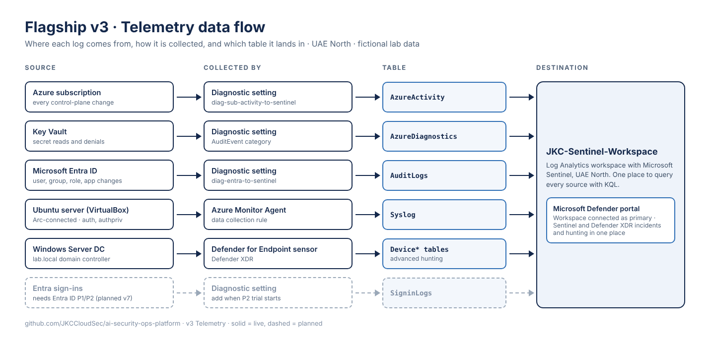
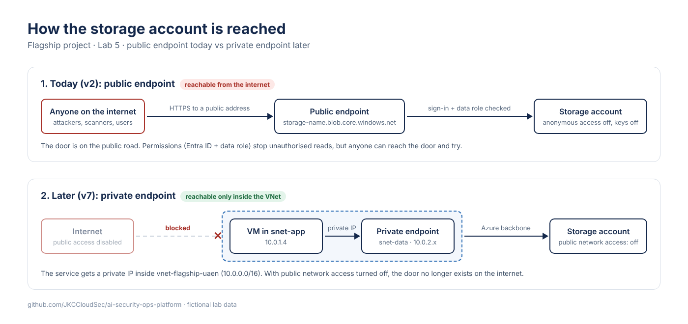

# v3 Telemetry

v3 brings logs from identity, cloud, Linux and Windows into one Microsoft Sentinel workspace, connected to the Microsoft Defender portal, and adds a segmented virtual network. All data is fictional lab data. Account and subscription identifiers are removed.

## Log sources

| Source | Collected by | Table | Status |
|---|---|---|---|
| Azure subscription | Diagnostic setting `diag-sub-activity-to-sentinel` | AzureActivity | Live (v1) |
| Key Vault | Diagnostic setting (AuditEvent) | AzureDiagnostics | Live (v2) |
| Microsoft Entra ID | Diagnostic setting `diag-entra-to-sentinel` | AuditLogs | Live (v3) |
| Ubuntu server, Arc-connected | Azure Monitor Agent with a data collection rule | Syslog (auth, authpriv) | Live (v3) |
| Windows Server domain controller | Defender for Endpoint sensor | DeviceInfo, DeviceProcessEvents and other Device* tables | Live (v3) |
| Entra ID sign-ins | Diagnostic setting | SigninLogs | Planned: needs Entra ID P1/P2 |

The workspace is connected to the Defender portal as the primary workspace, so Sentinel and Defender XDR incidents and advanced hunting are in one place. Defender tables use `Timestamp`; Sentinel tables use `TimeGenerated`.

New queries: [004 Linux auth](../../sentinel/kql/004-linux-auth-syslog.kql), [005 Entra user changes](../../sentinel/kql/005-entra-audit-user-changes.kql), [006 Defender device inventory](../../sentinel/kql/006-defender-device-inventory.kql).

## Network segmentation

| Item | Value |
|---|---|
| Virtual network | `vnet-flagship-uaen`, 10.0.0.0/16, UAE North |
| App subnet | `snet-app`, 10.0.1.0/24 |
| Data subnet | `snet-data`, 10.0.2.0/24 |
| Reserved | 10.0.0.0/24 kept free for gateway or Bastion subnets |
| Outbound internet | Private subnets: no default outbound access |

NSG `nsg-snet-data`, attached to `snet-data`, inbound rules:

| Priority | Name | Source | Destination | Port | Protocol | Action |
|---|---|---|---|---|---|---|
| 100 | Allow-App-to-Data-SQL | 10.0.1.0/24 | 10.0.2.0/24 | 1433 | TCP | Allow |
| 200 | Deny-VNet-to-Data | VirtualNetwork | 10.0.2.0/24 | Any | Any | Deny |
| 65000+ | Azure defaults | | | | | |

Rule 200 deliberately overrides the default AllowVnetInBound rule, so only SQL from the app subnet can reach the data subnet. Side effect: hosts inside snet-data cannot reach each other; a cluster would need an extra allow rule.

Found while building: the first version of rule 200 kept the portal's example port 8080, so it blocked only one port and left SSH and everything else open through the default rule. Fixed to Any. Lesson: check the port column, not the rule name.

Rule check (worked without a test VM, to stay at zero cost):

| Request | Result | Deciding rule |
|---|---|---|
| snet-app to snet-data, TCP 1433 | Allow | 100 |
| snet-app to snet-data, TCP 22 | Deny | 200 |
| Internet to snet-data, TCP 3389 | Deny | 65500 |
| snet-data to snet-data, TCP 1433 | Deny | 200 |
| snet-app to snet-data, UDP 1433 | Deny | 200 |

## Temporary admin access

Connecting Entra logs needed one account with both Entra admin rights and access to the workspace. The lab admin account was given Owner for the setup only, then removed.

| Time (UTC) | Event | Evidence |
|---|---|---|
| 08:51 | Owner granted to the lab admin account | AzureActivity, ROLEASSIGNMENTS/WRITE |
| 08:55 to 09:05 | Entra AuditLogs diagnostic setting created; Defender portal connection confirmed | Entra and Defender portals |
| 09:11 | Owner removed | AzureActivity, ROLEASSIGNMENTS/DELETE |

Privileged time: 21 minutes. In production this would be done with Privileged Identity Management (planned v7).

IAM review finding: the subscription had a duplicate Owner assignment for the same user. One was removed so the privileged-access list stays clean and auditable.

## Not done yet

- SigninLogs: needs an Entra ID P1/P2 licence.
- Effective security rules and IP flow verify: need a running VM; deferred to keep v3 free.
- Private endpoint for storage: planned for v7.
